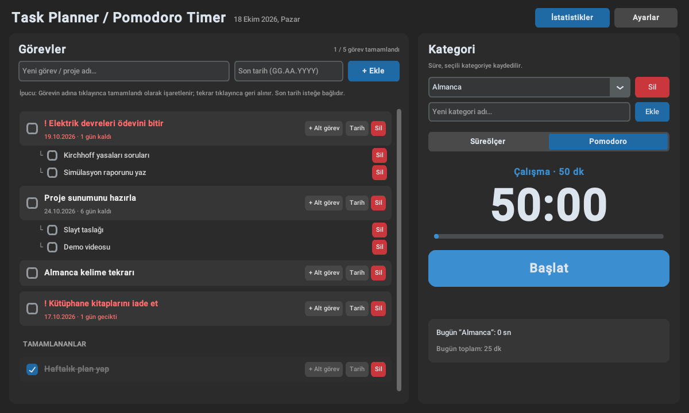
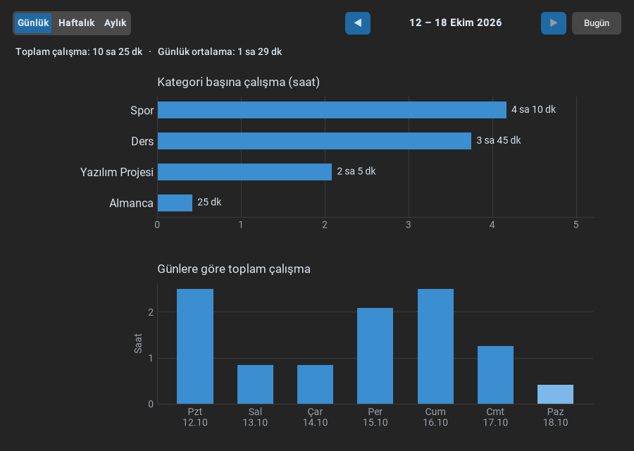
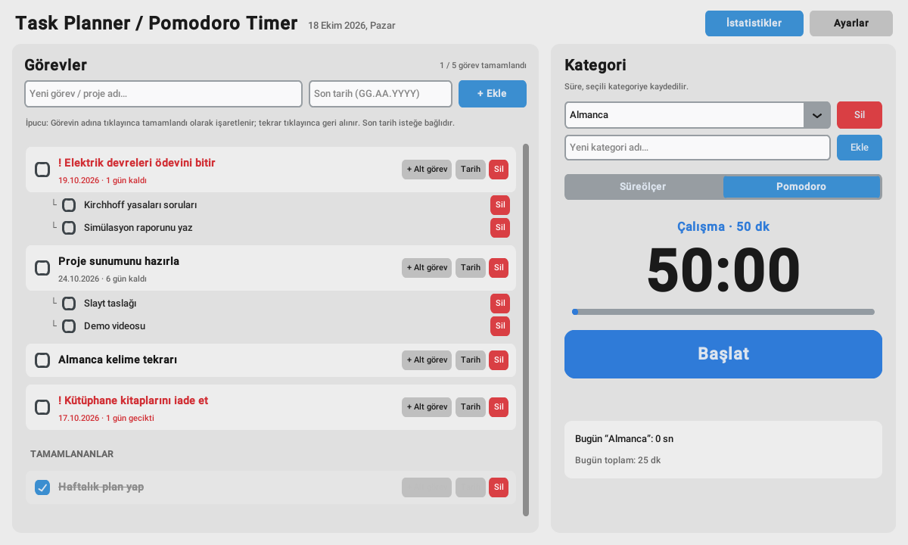

<p align="center">
  
</p>

<h1 align="center">Task Planner / Pomodoro Timer</h1>

<p align="center">
  Görevlerini planla, Pomodoro ile odaklan, nereye ne kadar zaman harcadığını gör.<br>
  Python + customtkinter · yerel SQLite · Windows için tek dosyalık <code>.exe</code>
</p>

<p align="center">
  <a href="../../releases/latest"><b>⬇ Exe'yi indir (Windows)</b></a>
</p>



## Özellikler

- **Görev planlayıcı:** Ana görev + alt görevler, isteğe bağlı son tarih (`15.10.2026`, `bugün`, `yarın`).
  Tamamlananlar üzeri çizili olarak en alta iner; süresi geçen/yaklaşan görevler kırmızı gösterilir.
- **Pomodoro ve süreölçer:** Kategori seç, başlat; Pomodoro'da çalışma bitince süre otomatik kaydedilir,
  melodi çalar ve mola başlar. Varsayılan 50 dk çalışma / 10 dk mola (ayarlanabilir).
- **İstatistikler:** Günlük / haftalık / aylık, kategori ve güne göre çalışma süreleri grafikleri.
- **Koyu / açık / sistem teması**, Türkçe arayüz ve Türkçe harf duyarlı sıralama.
- **Tamamen yerel:** Hesap yok, internet yok; tüm veri tek bir SQLite dosyasında.

| İstatistikler (koyu) | Ana ekran (açık) |
|---|---|
|  |  |

> Ekran görüntülerindeki görevler ve süreler örnek verilerdir.

## Kurulum

### Windows exe (önerilen)

1. [Releases](../../releases/latest) sayfasından `TaskPlannerPomodoro.exe` dosyasını indir.
2. İstediğin bir klasöre koy ve çift tıkla. Python gerekmez.

Windows SmartScreen "bilinmeyen yayıncı" uyarısı verirse **Ek bilgi → Yine de çalıştır** de;
exe imzasızdır ve kaynak kodu bu depodadır.

### Kaynak koddan

```bash
pip install -r requirements.txt
python main.py
```

Kendi exe'ni derlemek istersen Windows'ta `Exe_Olustur.bat` dosyasını çalıştır
(PyInstaller kurar, `TaskPlannerPomodoro.exe` üretir ve masaüstüne simgeli kısayol koyar).

## Verilerin nerede?

Veriler exe'nin (veya `main.py`'nin) yanındaki `veriler/verimlilik.db` dosyasında tutulur;
klasör ilk açılışta otomatik oluşur. Yedeklemek için bu dosyayı kopyalaman yeterli.
Exe'yi başka klasöre taşırsan `veriler` klasörünü de birlikte taşı.
Bu klasör `.gitignore` ile depoya dahil edilmez, kişisel verilerin paylaşılmaz.

## Kullanım

- **Görev ekleme:** Görev adını yaz, istersen son tarih gir, Enter veya **+ Ekle**.
- **Tamamlama:** Görevin adına ya da kutucuğuna tıkla; ana görev tamamlanınca alt görevleri de tamamlanır.
- **Zamanlayıcı:** Kategori seç → **Başlat** → **Duraklat** → **Devam Et**. **Bitir ve Kaydet** geçen süreyi
  seçili kategoriye bugünün tarihiyle kaydeder.
- Oturum sürerken uygulamayı kapatırsan geçen çalışma süresi yine kaydedilir.

Ayrıntılı anlatım için [KULLANIM.txt](KULLANIM.txt) dosyasına bak.

## Proje yapısı

```
main.py                  Giriş noktası
assets/                  Uygulama simgesi (icon.ico, icon.png)
tools/make_icon.py       Simgeyi üreten betik (Pillow)
build_exe.ps1            Exe derleme betiği (Exe_Olustur.bat çağırır)
.github/workflows/       Etiket (v*) gönderilince Windows exe derleyip Release'e ekler
docs/screenshots/        README görselleri
app/
  database.py            SQLite katmanı (Categories, Tasks, TimeLogs, Settings)
  timer_logic.py         Arayüzden bağımsız zamanlayıcı motoru
  sound.py               Uyarı melodileri (winsound, ayrı iş parçacığında)
  utils.py               Türkçe harf/sıralama, tarih ve süre yardımcıları
  ui/
    main_window.py       Ana pencere (üst çubuk + iki panel)
    task_panel.py        Sol panel: görevler / alt görevler
    timer_panel.py       Sağ panel: kategoriler + zamanlayıcı
    stats_window.py      İstatistik penceresi (matplotlib)
    settings_window.py   Ayarlar penceresi
    dialogs.py           Türkçe butonlu diyaloglar
    theme.py             Renkler ve yazı tipleri
```

## Yeni sürüm yayınlama

```bash
git tag v1.1.0
git push origin v1.1.0
```

GitHub Actions Windows üzerinde exe'yi derler ve Release olarak yayınlar.
